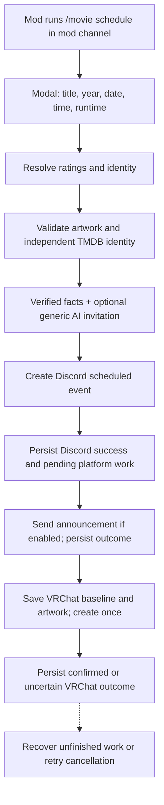
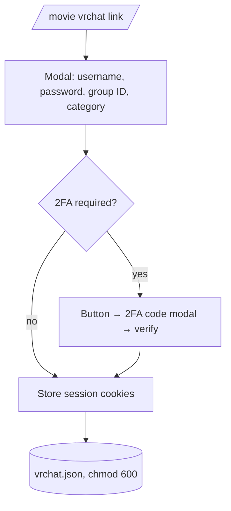

# 🎬 Movie Night Bot

A focused, **least-privilege** Discord bot that lets server mods schedule movie
nights. For each one it creates a native Discord **scheduled event** in the
guild's movie voice channel and posts a whimsical **announcement** in the
guild's announcements channel. Film facts come from verified TMDB metadata;
optional AI copy adds a generic invitation.

No `Administrator`. No privileged intents. Each server's mods configure their
own channels, ping role and timezone.

---

## Features

All commands are grouped under `/movie`, including `/movie config` and
`/movie vrchat`. The former hyphenated top-level commands are no longer registered.

- **`/movie schedule`** — opens a form (title / year / date / time / runtime), then:
  - creates a Discord scheduled event (with a 16:9 backdrop image when found), and
  - posts a styled announcement, optionally pinging a configurable role.
  - The **date and time fields are pre-filled** one week after this server's latest
    upcoming event (same start time), so back-to-back weekly bookings need no retyping.
    The suggestion is fully editable, and only appears when at least one upcoming
    event exists.
  - A **`type`** option (Movie / TV Series / Anime / Other) plus the start time
    make the event name and announcement adapt to the show and time of day —
    e.g. *Movie Night*, *Anime Matinée*, *Series Night*, *Morning Binge*.
    (Daypart buckets: Morning 05:00–11:59, Afternoon 12:00–17:59, Night
    18:00–04:59. Default type is Movie.)
  - A **`vrchat`** option (default *yes* when a VRChat group is linked) — set
    `vrchat:False` for a Discord-only watch party that skips the VRChat event.
- **`/movie test`** — dry-run that verifies config and all required permissions
  (Manage Events, channel visibility, send/embed/attach, ping role) **without**
  posting anything. Run this before the first real `/movie schedule`.
- **`/movie unfuck`** — in the mod channel, pick a bot-managed upcoming booking
  by title and local date, then describe a wrong film or artwork problem. Give
  the intended title/year or IMDb ID when the saved movie is wrong. Pick a TMDB
  match, browse available covers (or attach your own with `image:`), and review
  the private preview. Only **Apply repair** edits the existing event, linked
  VRChat event and existing bot announcement. Artwork-only repairs leave text
  alone. Identity repairs replace the film details and Discord ratings but never
  move the booking. No fresh announcements, role pings or calendar events are
  created. After a partial failure, retry just the unfinished steps.
- **`/movie cancel`** — autocompletes this server's upcoming movie nights and
  deletes **both** the scheduled event and the announcement message.
- **`/movie help`** — posts an ephemeral guide listing every command and what it does.
- **`/movie config set | show | clear`** — per-guild configuration.
- **AI content** via the [GitHub Copilot CLI](https://github.com/github/copilot-cli):
  optional generic invitation copy, with no tool use or film research. The
  synopsis and people come from verified TMDB metadata. A failed lookup uses
  a plain template instead of invented facts; unavailable AI does not discard
  verified metadata. `use_copilot` controls the optional invitation.
- **Independent ratings:** OMDb is queried first for exact IMDb and Rotten
  Tomatoes scores, with MDBList as a fallback when OMDb has no usable ratings.
  Anime/TV labels ending in `episode 10`, `ep. 10` or `S1E10` can safely fall
  back to the exact parent-series title. Movies use exact titles except for
  the documented, verified Gremlins 2 alias.
- **IMDb and Rotten Tomatoes ratings** from MDBList appear below Runtime in
  Discord announcements and in the Discord event description. Rotten Tomatoes
  means the critics' score, not the audience score. These scores are fetched
  separately from the AI copy and are never added to VRChat event descriptions.
- **VRChat group calendar (optional):** if a server links a VRChat group, each
  movie night also creates a **VRChat group calendar event**, and `/movie cancel`
  removes it too. See [VRChat integration](#vrchat-integration-optional).

---

## How it works



Per-guild state lives in JSON files next to `bot.py`:

| File | Purpose | Committed? |
| --- | --- | --- |
| `token` | bot token (or use `MOVIE_BOT_TOKEN`) | no (gitignored) |
| `mdblist.key` | optional private ratings key file; `pass` is the default | no (gitignored) |
| `config.json` | global defaults | no |
| `guilds.json` | per-guild channel/role/tz config | no |
| `events.json` | scheduled events the bot created (for cancel) | no |
| `vrchat.json` | per-guild VRChat session cookies + linked group | no (chmod 600) |
| `bot.log` | runtime log | no |

---

## Required Discord setup

### Permissions (integer `17600777079808` — **not** Administrator)

| Permission | Why |
| --- | --- |
| View Channels | see configured channels |
| Send Messages | post announcements |
| Embed Links | render link previews |
| Attach Files | attach the backdrop image |
| Connect | required to schedule a **voice-channel** event |
| Create Events | create scheduled events |
| Manage Events | edit/delete scheduled events |

> **Note:** Discord split event permissions into **Create Events** (to create)
> and **Manage Events** (to edit/delete any). Creating a scheduled event needs
> **Create Events** — an invite with only Manage Events will fail with a
> `Forbidden` error. For a *voice* event the bot also needs **View Channel** and
> **Connect** on the target voice channel.

### Invite scopes

`bot` + `applications.commands`

### Invite URL

```
https://discord.com/api/oauth2/authorize?client_id=YOUR_APP_ID&scope=bot+applications.commands&permissions=17600777079808
```

Gateway intents: **guilds only** (no Message Content / Members / Presence).

---

## Install

Requires **Python 3.10+** (CI covers 3.10 and 3.11) and, for AI content, the
**GitHub Copilot CLI** on the host.

```bash
git clone https://github.com/M1XZG/movie-night-bot.git
cd movie-night-bot

python3 -m venv .venv
.venv/bin/pip install -r requirements.txt

cp config.example.json config.json        # edit if you like
echo "YOUR_BOT_TOKEN" > token && chmod 600 token   # or export MOVIE_BOT_TOKEN

.venv/bin/python bot.py
```

### Ratings setup

Create API keys for [OMDb](https://www.omdbapi.com/apikey.aspx) and
[MDBList](https://mdblist.com/preferences/#api), then store them with the Linux
password manager:

```bash
pass insert api/omdb
pass insert api/mdblist
```

The bot queries OMDb first and falls back to MDBList if OMDb has no usable
IMDb or Rotten Tomatoes score. It keeps both keys only in process memory and
never logs them or stores them in event records. `pass` and the relevant GPG key
must be available to the service account.

For another setup, use `OMDB_API_KEY` / `MDBLIST_API_KEY`, the corresponding
`*_API_KEY_FILE` settings, or `OMDB_PASS_ENTRY` / `MDBLIST_PASS_ENTRY`.
Environment key, explicit key file, then `pass` is the lookup order. Restart
the bot after rotating a loaded key.

Both providers are checked against the exact title, media type and requested
year. Anime and TV labels ending in forms such as `episode 10`, `ep. 10` or
`S1E10` can retry the exact parent-series title. Movie titles are never
rewritten. Supply the year for remakes or common titles.

If both providers omit a score, that source is shown as **unavailable**.
Provider or credential failures produce a private warning to the scheduling
mod; the movie can still be scheduled. The bot does not substitute TMDB,
audience or composite scores.

Ratings include attribution to the provider that supplied them. They may
differ from a later visit to the original sites. Existing events and
announcements are not backfilled automatically.

### Backdrop images

The bot uses the [official TMDB API](https://developer.themoviedb.org/docs)
instead of scraping TMDB's website. Website search can reject automated
requests with HTTP 403 even when the API and image CDN work.

Create a developer credential in your [TMDB API settings](https://www.themoviedb.org/settings/api),
then store the **API Read Access Token** with:

```bash
pass insert api/tmdb
```

The bot reads the first line without prompting. The service account must be
able to decrypt that entry. A v3 API key in the same entry also works.
Alternatively set `TMDB_READ_ACCESS_TOKEN` or `TMDB_API_KEY`, or provide a
private file through `TMDB_TOKEN_FILE` or `TMDB_API_KEY_FILE`. Environment
credentials take precedence over explicit files, then `pass`; `TMDB_PASS_ENTRY`
changes the entry name. Never commit a credential.

The ratings lookup runs first. When it identifies an IMDb title, the bot uses
that identifier to find the same movie or series on TMDB rather than searching
again by name. This avoids confusing films that share both a title and a year.
The TMDB result must still match the selected media type. An identifier inferred
from ratings must independently match the original requested title and year.
An identity mismatch discards the inferred identifier and scores rather than
letting them identify the wrong film in generated copy.

Use `/movie schedule imdb:tt31349844` to pin a particular film or series explicitly.
The identifier becomes authoritative for ratings and backdrop lookup, so an
event label such as a season name does not need to match the provider's
canonical title. If a provider returns a different IMDb identity, its scores
are omitted with a warning rather than showing another title's ratings.

Without an IMDb identity, lookup requires one exact title/year match and checks
up to five search pages. It uses the movie or TV catalogue appropriate to the
chosen type and supports parent-series lookup for TV/anime episode titles.
Ambiguous matches are reported instead of selecting the first film. Supply
the release year for remakes; title and year alone can still be ambiguous.
The verified abbreviation Gremlins 2 resolves to Gremlins 2: The New Batch
(1990). Unknown aliases are not guessed; select the canonical title or provide
an explicit IMDb identifier.

Backdrops are fully decoded and converted to 1280 x 720 JPEGs before being
used on Discord and converted to PNG for VRChat. Successful lookups are
cached by title, year, show type and IMDb identity provenance under `tmp/backdrops/` next to the bot,
or under `MOVIE_BOT_TMP/backdrops/`. Versioned manifests verify the selected
identity, image digest and a 30-day age limit. Valid images within that limit
work without an API request or credential. Invalid, expired or legacy cache
entries are refreshed; immutable image files prevent concurrent writers from
mixing cache metadata and artwork.
To fetch a newer image for a title, remove its individual cached JPEG.

Use `/movie schedule image:` to attach your own landscape JPEG, PNG or WebP
(under 8 MB, at least 320 x 180) before opening the schedule form.
This bypasses TMDB and uses the same validation and uploads for both platforms.
If an image cannot be acquired, scheduling still works, but the mod receives
a private warning and the failure is logged. VRChat conversion/upload failures
are also reported privately. Existing events are not changed automatically.

The standalone helper keeps its original title/year interface:

```bash
python3 find_backdrop.py "Secondhand Lions" 2003
python3 find_backdrop.py "Runner" 2026 --imdb-id tt31349844
python3 find_backdrop.py "A Series episode 10" 2026 --show-type tv
```

It prints the cached image path on success; failures print `NONE`, return a
non-zero exit status and explain the error on stderr.

### TMDB credits


Backdrops are supplied by [The Movie Database](https://www.themoviedb.org).
This product uses the TMDB API but is not endorsed or certified by TMDB.
The bot's `/movie help` includes the same credit and logo. The PNG is rendered
from TMDB's [approved blue short logo](https://www.themoviedb.org/assets/v4/logos/v2/blue_short-8e7b30f73a4020692ccca9c88bafe5dcb6f8a62a4c6bc55cd9ba82bb2cd95f6c.svg)
without changing its colours or proportions.

### Tests

```bash
python -m unittest discover -s tests -v
```

The tests mock the provider and Discord/VRChat network calls. No real key,
Discord event or announcement is used.

### Run as a systemd user service

```bash
cp movie-night-bot.service ~/.config/systemd/user/
# edit paths inside the unit if your clone isn't at ~/movie-night-bot
systemctl --user daemon-reload
systemctl --user enable --now movie-night-bot
journalctl --user -u movie-night-bot -f
```

> **AI content gotcha:** the bot calls the `copilot` CLI as a subprocess. Under
> systemd's minimal `PATH`, an old system `node` can be picked up and break the
> Copilot loader (`SyntaxError: Unexpected token '?'`). The bot mitigates this
> by prepending the `copilot` binary's own `bin/` dir to the subprocess `PATH`.
> If you still see template-only posts, set an explicit `Environment=PATH=...`
> in the unit (see the commented line in `movie-night-bot.service`).

---

## Configure a server (per guild)

A mod with **Manage Events** runs, in the channel that should become the mod
channel:

```
/movie config set mod_channel:#mods announce_channel:#announcements voice_channel:🔊 Movie Night ping_role:@Movie Pings timezone:Europe/London
```

Then check it:

```
/movie config show
```

To create the Discord event (and VRChat event) **without** posting an
announcement — e.g. an events-only server — turn announcements off:

```
/movie config set announcements:False
```

Set `announcements:True` to turn posting back on. The announcements channel is
still required either way, so it's ready when you re-enable it.

Now schedule one (must be run in the configured mod channel):

```
/movie schedule                       # defaults to a Movie
/movie schedule type:🌸 Anime         # wording becomes Anime Night / Anime Matinée / …
/movie schedule type:📺 TV Series     # Series Night / Series Matinée / Morning Binge
/movie schedule vrchat:False          # Discord-only — skip the VRChat event this time
```

…and cancel if needed:

```
/movie cancel   # pick from the autocomplete list
```

### Config options

| Option | Notes |
| --- | --- |
| `mod_channel` | channel for scheduling, repairing and cancelling bookings |
| `announce_channel` | where announcements are posted |
| `voice_channel` | the scheduled event's voice channel |
| `ping_role` | optional role to ping at the top (use `@everyone` for everyone) |
| `timezone` | IANA tz name, e.g. `America/New_York` (default from `config.json`) |

`config.json` global defaults:

| Key | Default | Meaning |
| --- | --- | --- |
| `default_timezone` | `Europe/London` | fallback tz |
| `use_copilot` | `true` | enable the optional generic AI invitation |
| `copilot_timeout` | `90` | seconds to wait for Copilot |
| `default_runtime_minutes` | `120` | event length when runtime omitted |

---

## Security notes

- Slash commands are gated with `default_permissions(manage_events=True)` and
  `guild_only()`; `/movie schedule` and `/movie cancel` are additionally restricted to
  the configured mod channel.
- The bot requests **no privileged intents** and uses `Intents.none()` +
  `guilds`. It never reads message content.
- Secrets (`token`) and per-instance state are gitignored. Use
  `MOVIE_BOT_TOKEN` to keep the token out of the filesystem entirely.

---

## VRChat integration (optional)

If a server runs movie nights inside a VRChat **group**, the bot can also create
a matching event on that group's **calendar** — and remove it when you cancel.

### How linking works

VRChat has **no OAuth**, so the only way to get a session is username + password
+ 2FA. Linking is therefore a one-time, self-service flow per server:

1. A mod runs **`/movie vrchat link`**.
2. A modal asks for the VRChat **username**, **password**, **group ID**
   (`grp_…`) and an optional event **category** (default `film_media`).
3. If the account has 2FA, the bot replies with an *Enter 2FA code* button →
   another modal collects the email/authenticator code.
4. The bot verifies and stores **only the resulting session cookies** (in
   `vrchat.json`, `chmod 600`) — **never the password**.



### Commands

| Command | What it does |
| --- | --- |
| `/movie vrchat link` | start the credential + 2FA flow (one-time per server) |
| `/movie vrchat status` | show the linked account/group and check if the session is still valid |
| `/movie vrchat early-start` | start the VRChat event N minutes early (end time unchanged) |
| `/movie vrchat recover` | reconcile or resume a saved unfinished calendar booking after re-linking |
| `/movie vrchat unlink` | delete the stored session and group link |

Once linked, every `/movie schedule` also creates a VRChat group calendar event
(`POST /calendar/{groupId}/event`) using the movie's title, verified synopsis, and
start/end times; `/movie cancel` deletes it (`DELETE /calendar/{groupId}/{calendarId}`).
Pass `vrchat:False` on `/movie schedule` to skip the VRChat event for a single
Discord-only watch party.

Events are explicitly published with `isDraft:false` and target Windows,
Android and iOS clients. The bot checks the create response and reads incomplete
responses back before reporting success. If stored fields still cannot be
verified, it retains the accepted event ID and artwork for review instead of
deleting and recreating it. Draft or invalid-platform events are not reported as
successful. Both fields are required for reliable in-client start notifications.

**Early start (optional).** VRChat only fires its "event starting soon"
announcement when the event begins, so the notice can arrive after the movie has
already started. Run `/movie vrchat early-start minutes:10` to bring the VRChat
event's **start** forward by that many minutes (0 disables, max 60) — the **end
time is left unchanged**. Example: a 19:00 movie creates a VRChat event that
starts at 18:50 and still ends at the movie's real finish, so VRChat's heads-up
lands ~10 min before showtime. This affects the VRChat event only; the Discord
event/announcement still use the real start time.

**Event image.** The movie backdrop is converted to a PNG and uploaded to the
**linked account** (`POST /file/image`, tag `gallery`), and the returned
`file_…` id is set as the event's `imageId` — so the VRChat event shows the
movie image instead of the group's banner. When the event is cancelled, the
uploaded image is also deleted from the linked account
(`DELETE /file/{fileId}`), with a readback confirming that the file is gone.
Cancellation captures the calendar's current image before deleting the event
and also cleans artwork IDs saved in its payload or unfinished repairs.
Failed cleanup retains the booking for retry; artwork still needed by another
booking is not deleted. Image handling is best-effort: if Pillow is missing,
the upload fails, or no backdrop is found, the event simply falls back to the
group banner. (Requires `Pillow` — see `requirements.txt`.)

### Requirements & caveats

- The linked VRChat account must be a **member of the group with permission to
  manage calendar events**.
- Uploaded event images are owned by the **linked user account** (they appear in
  that account's gallery/files) and are removed on `/movie cancel`.
- The VRChat API is **unofficial**. The bot sends a descriptive `User-Agent`
  and makes only occasional calls; respect VRChat's rate limits and Terms.
- Session cookies expire eventually. Refresh the link, then explicitly recover
  an unfinished booking. Re-linking alone does not backfill calendar events.
- Discord modals don't mask the password field as you type, and the value
  transits Discord's interaction payload to the bot. Only link an account you
  control, on a bot host you trust. The bot stores **only** the session token.

---

## Failure recovery

The bot saves the Discord event before attempting the announcement or VRChat
work. Each confirmed side effect is checkpointed. A state-file failure stops
further writes, and corrupt booking state prevents startup rather than silently
discarding the cancellation index.

To recover a new booking missed during expired VRChat authentication, refresh
the link and select the saved booking:

```text
/movie vrchat link
/movie vrchat recover
```

Recovery reconciles an uncertain POST before doing anything else. It never
blindly creates another calendar event. Older bookings without a saved creation
payload still require reviewed manual backfill.

Repairs retain their selected identity, preview and uploaded image ID across
restarts. Reopen the repair picker to resume only unfinished targets:

```text
/movie unfuck
```

For inconsistent film text with correct covers, describe the problem as
`text only` and supply the intended IMDb identifier. The private preview keeps
existing artwork and booking times. Applying it sends no new announcements or
creation notifications.

Failed cancellations retain the booking and completed deletion steps. Retry
cancellation instead of scheduling or repairing the same booking. VRChat
artwork is deleted only after its calendar event is confirmed gone.

Generic request-duration logs and typed VRChat stage failures make future
problems distinguishable without logging credentials or response bodies.
Ambiguous Discord sends need manual reconciliation. An image upload accepted
without a returned file ID cannot be reliably located automatically. Conflicting
calendar matches also require review; the bot preserves uncertain state rather
than claiming success or blindly repeating the operation.

---

## License

[MIT](LICENSE)
